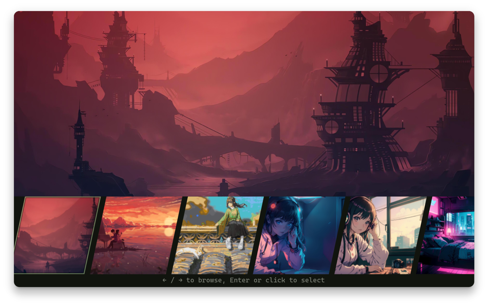
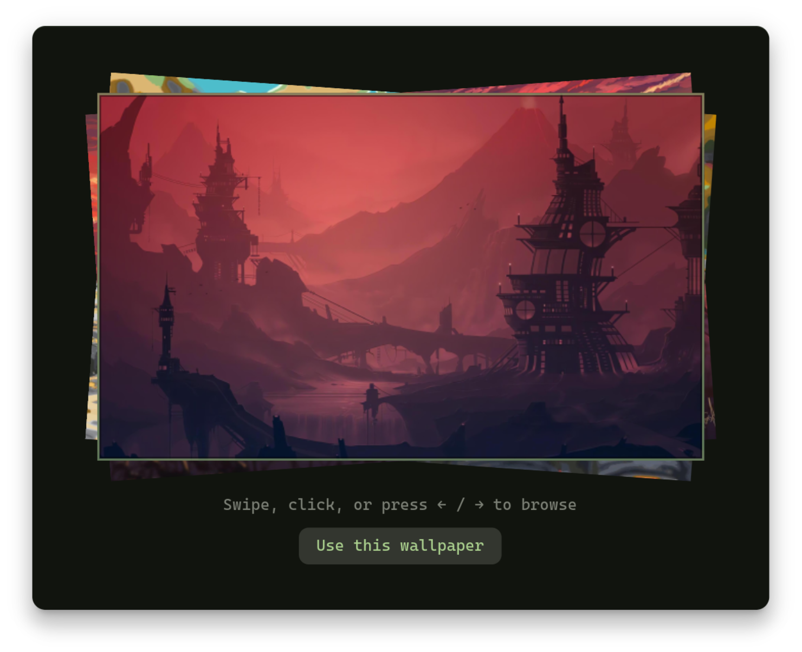
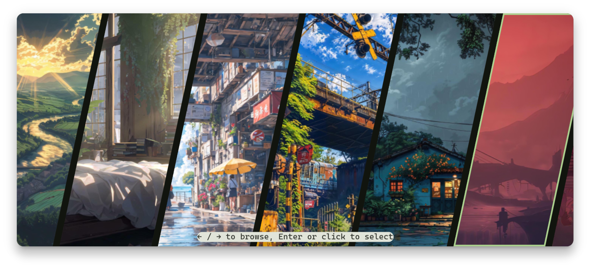
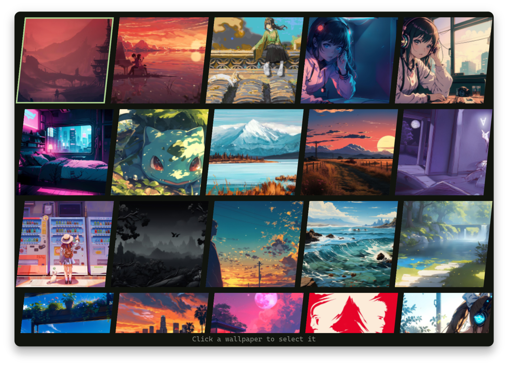
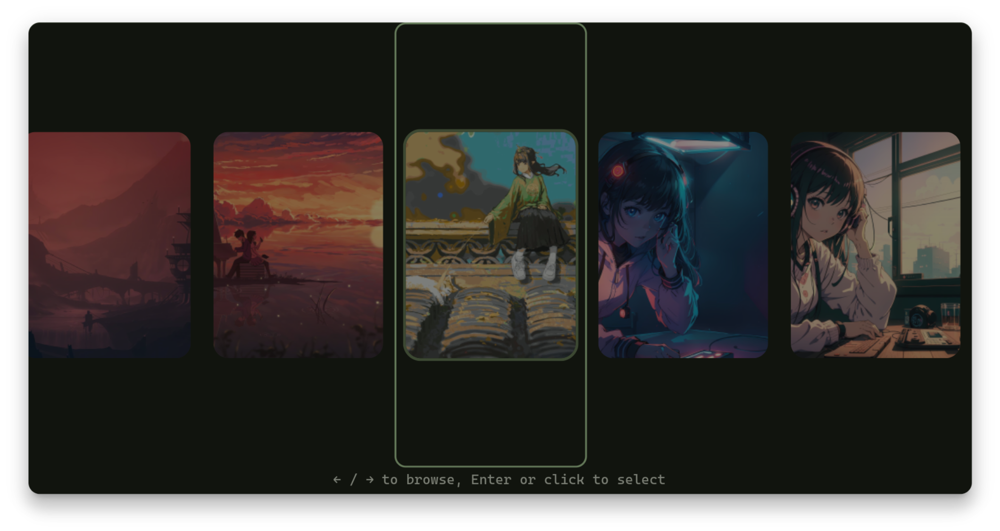
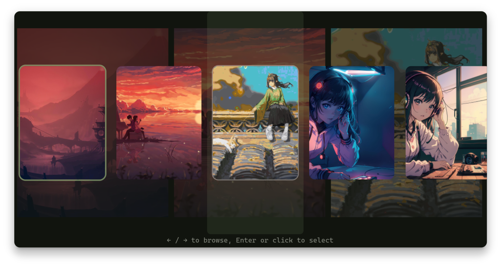
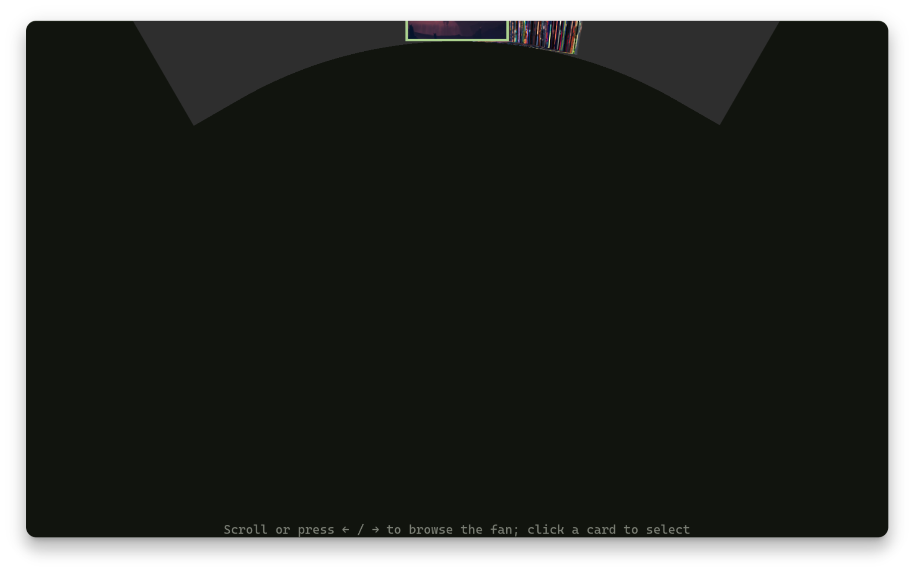
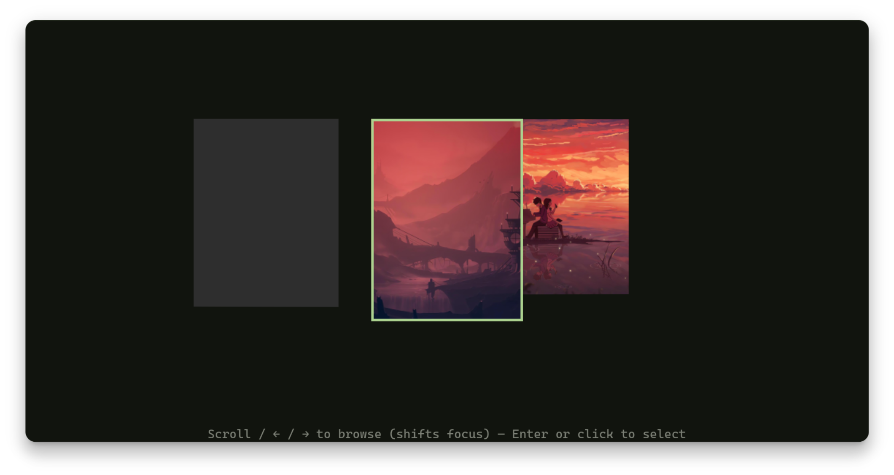

# Wallmat

A keyboard-friendly wallpaper chooser for **GTK 4 and libadwaita**, with eight experimental layouts and optional [Matugen](https://github.com/InioX/matugen) integration for wallpaper-driven desktop colors.

<p align="center">
  
</p>

<p align="center">
  <a href="LICENSE"></a>
  
  
</p>

## Layouts

<p align="center">
  
  
  
  
</p>
<p align="center">
  
  
  
  
</p>

- **Split-Screen Preview** — compare a wallpaper with a large preview.
- **Stacked Deck** — browse a layered stack of wallpapers.
- **Infinite Ribbon** — move through a continuous horizontal strip.
- **Masonry Grid** — explore a varied grid of thumbnails, with GTK virtualizing cells outside the viewport.
- **Glassmorphism** — browse through translucent layered cards.
- **Parallax Gallery** — move through a depth-inspired gallery.
- **Radial Fan** — fan wallpapers around the focused card.
- **Cylindrical Ring** — rotate a three-dimensional-style carousel.

## Quick start

Install the runtime dependencies on Debian or Ubuntu:

```sh
sudo apt install python3-gi gir1.2-gtk-4.0 gir1.2-adw-1
# Optional: WebP wallpaper and thumbnail support (when available)
sudo apt install webp-pixbuf-loader
```

Run Wallmat from a checkout:

```sh
python3 src/main.py ~/Pictures/Wallpapers
```

Without a folder argument, Wallmat uses `/usr/share/backgrounds`. Start in a specific layout with:

```sh
python3 src/main.py ~/Pictures/Wallpapers --layout infinite_ribbon
```

## Supported wallpaper formats

Wallmat scans PNG and JPEG images when their GdkPixbuf loaders are enabled. WebP is included only when the current session has an enabled WebP loader (for example, the optional `webp-pixbuf-loader` package on Debian/Ubuntu). Other formats are intentionally excluded because loader availability alone does not guarantee consistent GNOME desktop-background support.

## Controls

- **← / →** — move focus in layouts that support keyboard navigation.
- **Enter** — select the focused wallpaper where supported.
- **Click** — select a wallpaper; behavior differs in Stacked Deck and some interactive layouts. In normal UI mode, selected wallpapers show dimensions, aspect ratio, file size, modification time, and path.
- **Ctrl + F** — filter by filename or folder path.
- **Favorites only** — combine a favorites-only filter with the text filter (normal UI mode).
- **Sort** — order wallpapers by name, modification date, or a stable session shuffle; search and favorites filtering preserve the chosen order.
- **Surprise me** — immediately apply a random wallpaper from the current filtered results, avoiding the previous random choice when alternatives exist.
- **Escape** — clear the filter, or close the window when the filter is hidden.
- **? / Shortcuts** — open the keyboard shortcut cheatsheet, including layout-specific caveats.

Use the layout selector at the bottom of the window to switch layouts without restarting. When Wallmat's GSettings schema is installed, it remembers the chosen layout, text filter, sort mode, and Favorites only setting between launches. The selected wallpaper and layout scroll/focus position are not yet restored. Without the schema, preferences fall back to in-memory values for the current process. Exact controls vary by layout. Wallpaper actions wrap onto additional rows when the window is too narrow to show them side by side.

### Persisting preferences

Wallmat can run without installing its GSettings schema, but preferences then last only for the current process. To enable persistence for your user account from a source checkout:

```sh
mkdir -p ~/.local/share/glib-2.0/schemas
cp data/dev.sakib.Wallmat.gschema.xml ~/.local/share/glib-2.0/schemas/
glib-compile-schemas ~/.local/share/glib-2.0/schemas/
```

Restart Wallmat after installing or updating the schema. If `glib-compile-schemas` is unavailable, install the GLib development utilities provided by your distribution.

## Matugen integration

Use Wallmat as a wallpaper-path provider in a shell pipeline:

```sh
WP="$(python3 src/main.py ~/Pictures/Wallpapers --plain 2>/dev/null)"
matugen image "$WP" --type scheme-smart --mode dark
URI="$(python3 -c 'from pathlib import Path; import sys; print(Path(sys.argv[1]).resolve().as_uri())' "$WP")"
gsettings set org.gnome.desktop.background picture-uri "$URI"
```

In normal UI mode, **Set as wallpaper** updates GNOME's background settings. **Apply wallpaper + Matugen** also runs Matugen. Customize its arguments with `--matugen-args`:

```sh
python3 src/main.py ~/Pictures/Wallpapers --matugen-args="--type scheme-tonal-spot --mode light"
```

Matugen must be installed to use the Matugen action. In `--plain` mode, the selected absolute wallpaper path is the only stdout output.

## Favorites

Add selected wallpapers to favorites and export their absolute paths for other tools:

- Data: `~/.config/wallmat/favorites.json`
- Export: `~/.config/wallmat/favorites.txt`

Wallmat skips missing files when exporting favorites and reports how many were omitted. When saved favorites point to files that no longer exist, the **Remove missing favorites** action appears in the normal UI; it removes those stale entries from the saved favorites list while preserving existing files.

## License

Wallmat is licensed under **GPL-3.0-only**. See [LICENSE](LICENSE).
