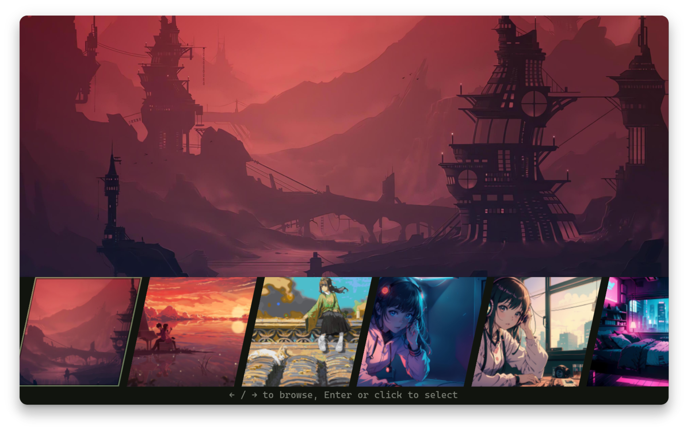
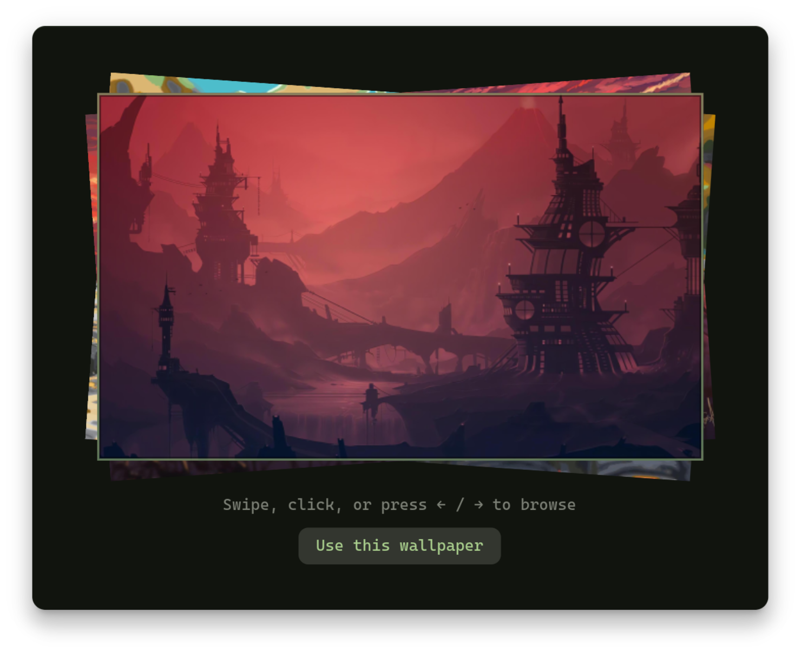
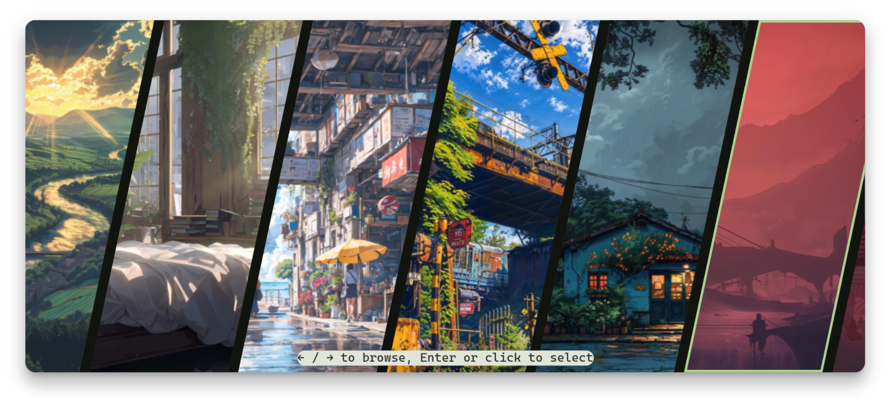
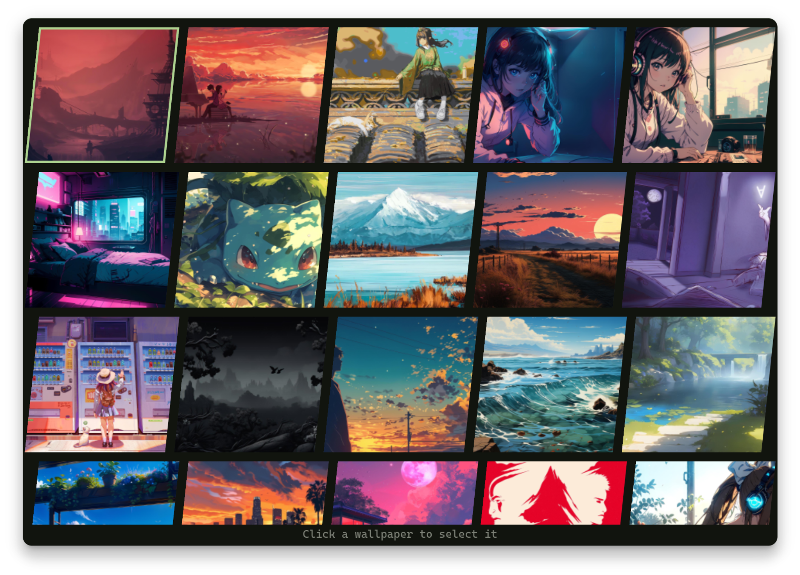
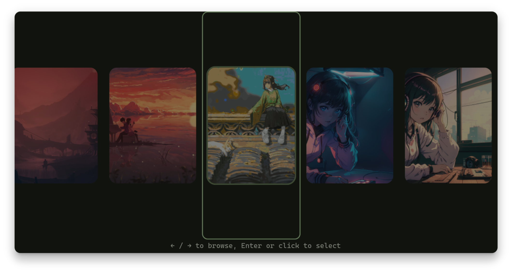
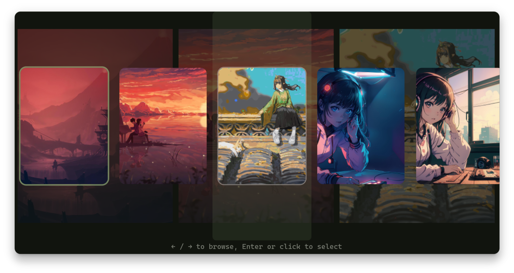
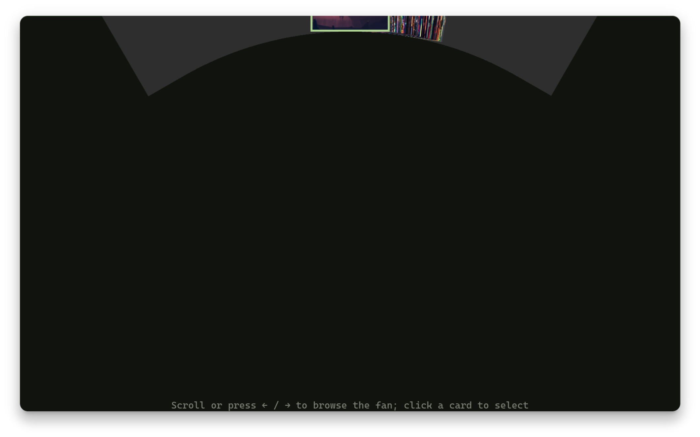
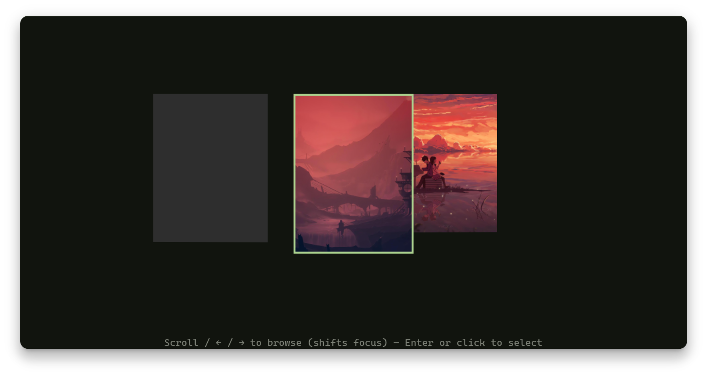

# Wallmat

A GTK4 / libadwaita wallpaper chooser for Linux, featuring eight layouts, favorites, collections, full-screen previews, and optional [Matugen](https://github.com/InioX/matugen) theming.

<p align="center">
  
</p>

<p align="center">
  <a href="LICENSE"></a>
  
  
</p>

## Layouts

<p align="center">
  
  
  
  
</p>
<p align="center">
  
  
  
  
</p>

| Layout | Style |
|---|---|
| Split-Screen | Large side-by-side preview |
| Stacked Deck | Layered cards |
| Infinite Ribbon | Continuous horizontal strip |
| Masonry Grid | Virtualized thumbnail grid |
| Glassmorphism | Translucent cards |
| Parallax Gallery | Depth effect |
| Radial Fan | Radial card arrangement |
| Cylindrical Ring | 3D-style carousel |

## Features

- Search, sorting, tags, and drag-and-drop folder switching
- Favorites, collections, recent wallpapers, and batch actions
- Full-screen preview with zoom and pan
- Wallpaper application through XDG Wallpaper portal / GNOME integration
- Optional Matugen color generation and preview
- Timed rotation, random selection, and wallpaper history
- Keyboard navigation, backup, and restore

## Installation

**Debian / Ubuntu**
```sh
sudo apt install python3-gi gir1.2-gtk-4.0 gir1.2-adw-1
```

**Fedora**
```sh
sudo dnf install python3-gobject gtk4 libadwaita
```

Run from the source directory:

```sh
python3 src/main.py ~/Pictures/Wallpapers
```

Default folder: `/usr/share/backgrounds`.

Choose a layout with `--layout`:

```sh
python3 src/main.py ~/Pictures/Wallpapers --layout infinite_ribbon
```

Optional WebP support: install `webp-pixbuf-loader`.

## Matugen and CLI

Use the selected wallpaper path in scripts:

```sh
WP="$(python3 src/main.py ~/Pictures/Wallpapers --plain 2>/dev/null)"
matugen image "$WP" --type scheme-smart --mode dark
```

The **Apply wallpaper + Matugen** action combines both steps. Customize Matugen arguments with `--matugen-args`.

On Wayland, wallpaper changes use the XDG Wallpaper portal. GNOME settings are used as a fallback when the portal is unavailable.

## Documentation

- [Features and controls](docs/FEATURES.md)
- [Configuration and supported formats](docs/CONFIGURATION.md)
- [Screenshot coverage](docs/SCREENSHOTS.md)

## License

[GPL-3.0-only](LICENSE)
